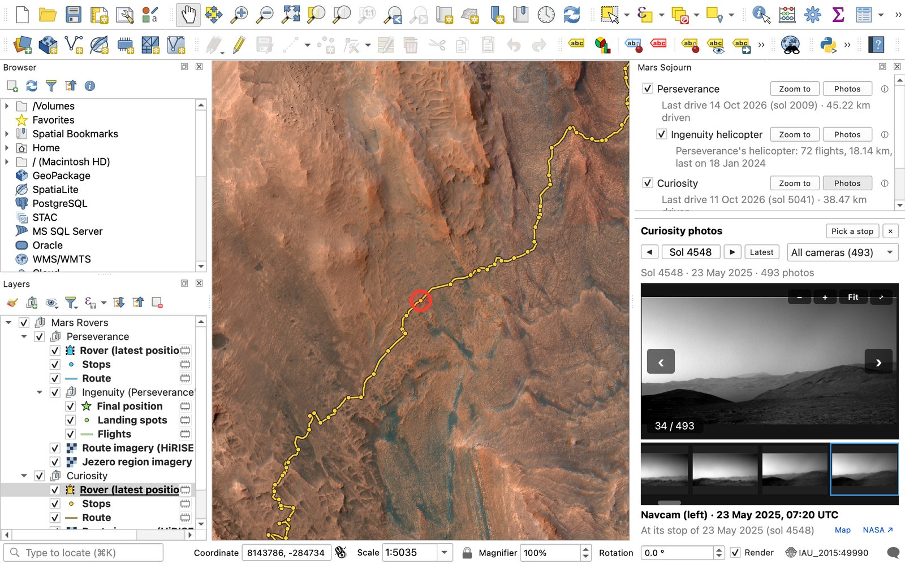
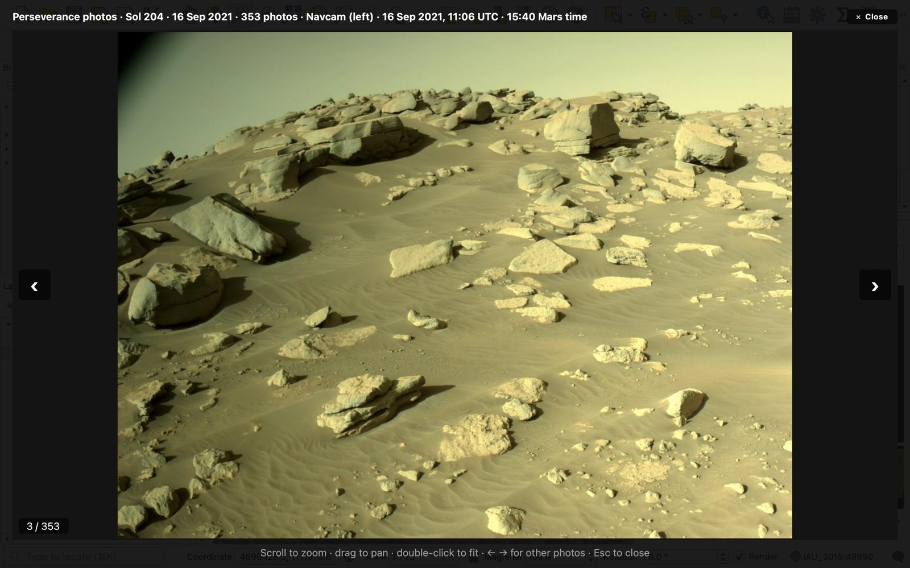

# Mars Sojourn

NASA's Mars rovers on a Mars map, in QGIS.

Mars Sojourn shows where Perseverance and Curiosity are now, every stop they have made and the routes they have driven since landing, over NASA orbital imagery that sharpens to close-up HiRISE colour around each route. The Ingenuity helicopter's 72 flights are included as a record.

## What you get

A "Mars Rovers" group in the Layers panel:

- **Perseverance** (Jezero crater): latest position, stops and route
- **Curiosity** (Gale crater): latest position, stops and route
- **Ingenuity** (Perseverance's helicopter): final resting place, landing spots, flights (2021 to 2024) and its own photos
- **Mars imagery**: a global colour mosaic, a 6 m mosaic of Gale crater and close-up HiRISE colour along both rover routes

Click a rover, stop or route with QGIS's Identify tool for the sol (Mars day since landing), distance driven, elevation and tilt.

## Photos

The bottom of the Mars Sojourn panel is a photo viewer with the rovers' raw photos, straight from NASA's raw-image feeds, usually within hours of reaching Earth. It opens on Perseverance's newest photos; the Photos button next to each rover switches to that rover.

- a strip of every photo from a sol, newest first, with a camera filter (Navcam, Mastcam-Z, Hazcams, WATSON, SuperCam and so on)
- earlier and later sols with the arrows, or type any sol
- click a thumbnail to see it in the preview: zoom with the mouse wheel or + and -, drag to pan, double-click to fit, arrow keys for the previous and next photo, ⤢ to see the photo large over the whole QGIS window (Esc closes), and full size on request
- each photo says where it was taken (rovers stamp their photos with counters that match the stops on the map), with a Show on map link
- Pick a stop, then click any stop on the map, to see the photos from that sol

Some raw frames are naturally dark or odd-looking: night-time and calibration shots, and partial frames with black around them. That is how NASA posts them.

## It is not live tracking

A rover's position changes only when it drives and NASA publishes the new spot. That is usually every few days, and sometimes not for weeks while a rover works in one place. Mars Sojourn draws each rover exactly where NASA last located it, turned to the heading NASA reports, and never estimates or animates movement.

Every hour Mars Sojourn also reads the newest photo NASA has posted from each rover. A rover's photos are stamped with counters that change only when it drives, so if the rover has driven and NASA has not mapped the new spot yet, the panel says so in amber.

## The map is on Mars

QGIS cannot mix Earth and Mars coordinates, so Mars Sojourn puts the map in a proper Mars projection (Mars Mercator, IAU 2015) and measures on the Mars sphere. The scale bar and the Measure tool give real Martian distances.

If your project is empty, Mars Sojourn switches the map to Mars for you. If it already holds layers of your own, it leaves the map alone and offers a "Switch map to Mars" button instead. Earth layers cannot be drawn on a Mars map, so use a separate project for those.

## Install

In QGIS: Plugins, Manage and Install Plugins, tick "Show also experimental plugins" in Settings, then search for Mars Sojourn. Works in QGIS 3.28 and later, including QGIS 4.

## Data sources

- Rover and helicopter positions, stops and routes: the GeoJSON files behind NASA's public rover location maps ([Perseverance](https://science.nasa.gov/mission/mars-2020-perseverance/location-map/), [Curiosity](https://science.nasa.gov/mission/msl-curiosity/location-map/)). These are not a documented service and could change without notice, which is why the plugin is marked experimental.
- Global mosaic: Viking colour mosaic (MDIM 2.1) from NASA Mars Trek. Credit NASA/JPL-Caltech/USGS.
- Gale crater mosaic: CTX. Credit NASA/JPL-Caltech/MSSS.
- Close-up imagery: HiRISE (public domain). Credit NASA/JPL/University of Arizona.
- Jezero region mosaic (black and white, about 10 m): CTX, from NASA Mars Trek. Credit NASA/JPL/MSSS.

No account or key is needed. Nothing is bundled with the plugin; everything is fetched from NASA as you use it. All of it is NASA data, used under NASA's images and media guidelines: not subject to copyright, NASA credited as the source, no NASA logos, and no suggestion of NASA endorsement.

Data courtesy NASA/JPL-Caltech. This plugin is not affiliated with or endorsed by NASA, JPL or Caltech.

## Notes

- Earth dates for stops are worked out from the sol number, at 13:00 Mars time, in UTC.
- A few Perseverance stops are labelled "Interpolated (not measured)". That is NASA's own flag for points filled in between two measured ones.
- NASA's Curiosity route file carries no sol numbers, so the route there is not dated; the stops are.

## Licence

GPL-2.0-or-later. See [LICENSE](LICENSE).
